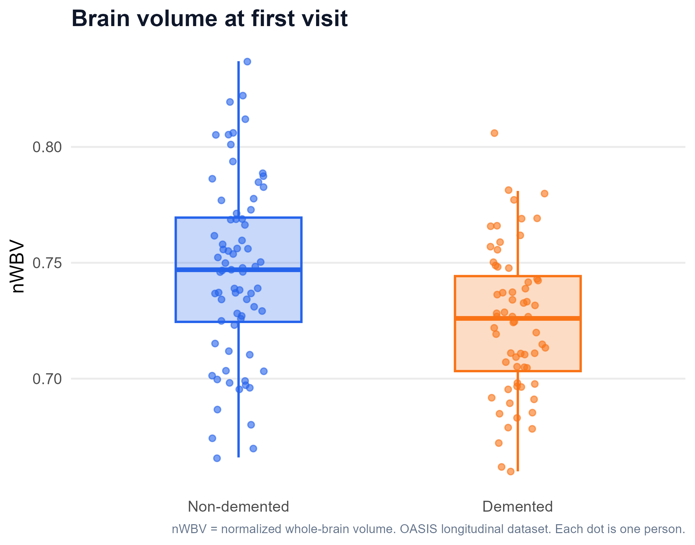
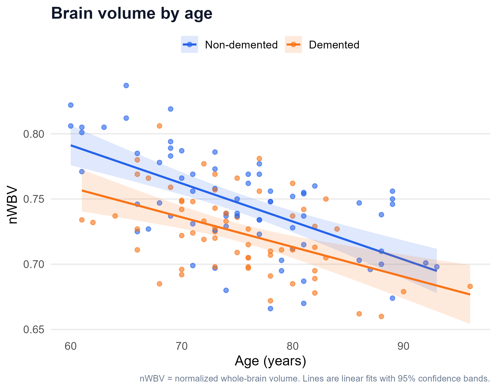
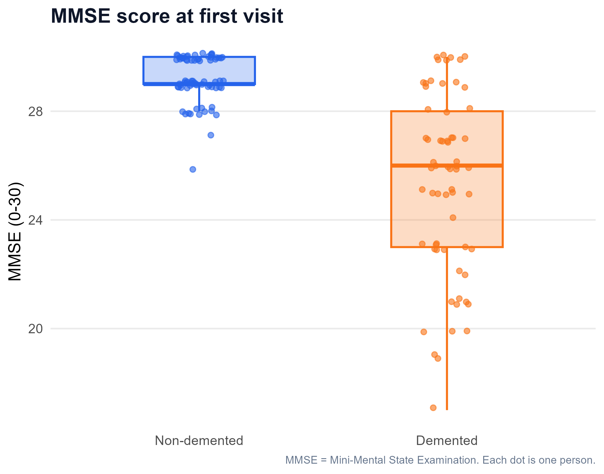
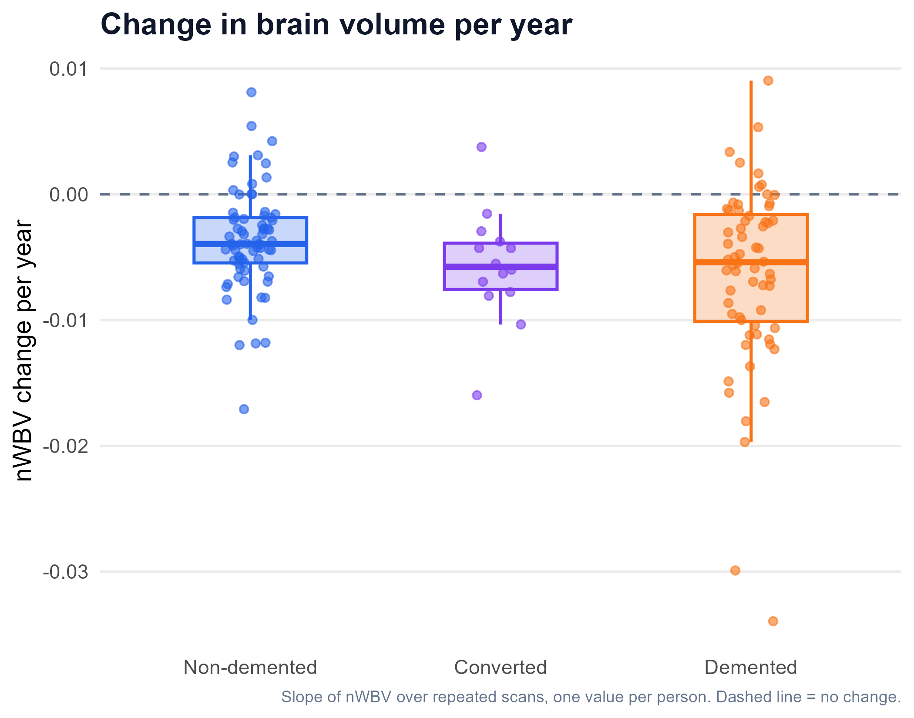

# Brain volume and dementia in the OASIS longitudinal MRI dataset

An exploratory analysis in R of brain volume, age and dementia status in older adults.

## Questions

1. At their first visit, does normalized whole-brain volume (nWBV) differ between demented and non-demented adults, after adjusting for age, sex and education?
2. Does brain volume change at a different rate in people who go on to develop dementia?

## Data

OASIS Longitudinal MRI dataset: 150 people, 373 scans in total (2-5 scans per person). The ages in the Kaggle file run from 60 to 98 (the original paper describes the sample as aged 60-96). Downloaded from Kaggle: https://www.kaggle.com/datasets/jboysen/mri-and-alzheimers

Original source: Marcus DS, Fotenos AF, Csernansky JG, Morris JC, Buckner RL. Open Access Series of Imaging Studies (OASIS): Longitudinal MRI Data in Nondemented and Demented Older Adults. *Journal of Cognitive Neuroscience*. 2010;22(12):2677-2684. doi:10.1162/jocn.2009.21407

The data file is not included in this repository, because the OASIS data are shared under their own data usage terms. Please download it from the link above and place it in `data/`.

The file holds measurements taken from the MRI scans, not the images themselves.

## Methods

- **Tools:** R, tidyverse (dplyr, tidyr, ggplot2, readr), broom.
- **Cleaning:** columns renamed; 19 missing SES values and 2 missing MMSE values noted (SES not used).
- **One row per person:** group comparisons use the first visit only, because each person has several scans and counting every scan would treat the same person as independent observations.
- **Groups:** 72 non-demented and 64 demented people at first visit. The 14 "Converted" people (non-demented at first, demented later) were excluded from the baseline comparison and used in the longitudinal analysis.
- **Group comparisons:** Wilcoxon rank-sum tests with Benjamini-Hochberg correction; chi-square test for sex.
- **Regression:** logistic regression (dementia yes/no) with nWBV (standardized), age, sex and education. MMSE and CDR were not used as predictors, because dementia status is partly defined by cognitive testing.
- **Longitudinal part:** for each person, a straight line was fitted through nWBV over time, and the slope (change per year) was compared between the three groups with a Kruskal-Wallis test and pairwise Wilcoxon tests.

## Results

### Baseline (first visit)

| | Non-demented (n = 72) | Demented (n = 64) |
|---|---|---|
| Mean age (years) | 75.4 | 75.1 |
| Mean nWBV | 0.746 | 0.724 |
| Median MMSE | 29 | 26 |
| Mean education (years) | 15.2 | 13.7 |

Wilcoxon tests (BH-adjusted p-values): nWBV 0.0018, education 0.0038, MMSE 5e-13 (expected by construction). Age (0.98) and head size, eTIV (0.98), did not differ. Sex distribution differed between groups (chi-square p = 0.004): 50 of the 72 non-demented people were women, compared with 28 of the 64 demented people.

### Logistic regression (demented vs non-demented)

| Predictor | Odds ratio | 95% CI |
|---|---|---|
| nWBV (per 1 SD higher) | 0.41 | 0.24 - 0.67 |
| Education (per year) | 0.80 | 0.69 - 0.92 |
| Male sex | 2.32 | 1.05 - 5.22 |
| Age (per year) | 0.93 | 0.87 - 0.99 |

Higher brain volume was associated with lower odds of dementia after adjusting for age, sex and education. The age coefficient is not interpreted: brain volume and age are related, and the two groups have almost the same mean age.

### Change in brain volume over time

| Group | n | Median change in nWBV per year |
|---|---|---|
| Non-demented | 72 | -0.0040 |
| Converted | 14 | -0.0058 |
| Demented | 64 | -0.0054 |

All three groups lost brain volume over time, as expected with ageing. Non-demented people tended to lose volume more slowly (by median, roughly 30% slower) than the other two groups. The overall difference was borderline (Kruskal-Wallis p = 0.049), and no pairwise comparison was significant after correction (Non-demented vs Converted p = 0.096, Non-demented vs Demented p = 0.096, Converted vs Demented p = 0.91). This should be treated as a preliminary observation.

## Limitations

- Small sample (136 people at baseline, 14 in the Converted group).
- Observational data: associations only, no causal claims.
- Dementia status is a clinical label, and group boxplots overlap substantially, so brain volume alone does not separate the groups.
- Sex is unevenly distributed between groups (adjusted for, but residual confounding is possible).
- The longitudinal analysis is simple (one slope per person). A mixed-effects model would be the next step.
- The model was not validated on separate data and was not built for prediction.

## How to run

1. Download `oasis_longitudinal.csv` from the Kaggle link above and put it in `data/`.
2. Open `oasis_analysis_final.R` in RStudio from the project folder.
3. Install packages if needed: `install.packages(c("tidyverse", "broom"))`.
4. Run the script. Figures are saved to `figures/`.

## Acknowledgements

Data were provided by the Open Access Series of Imaging Studies (OASIS), supported by grants P50 AG05681, P01 AG03991, R01 AG021910, P20 MH071616 and U24 RR021382. This is an independent educational analysis and is not affiliated with the OASIS project.
